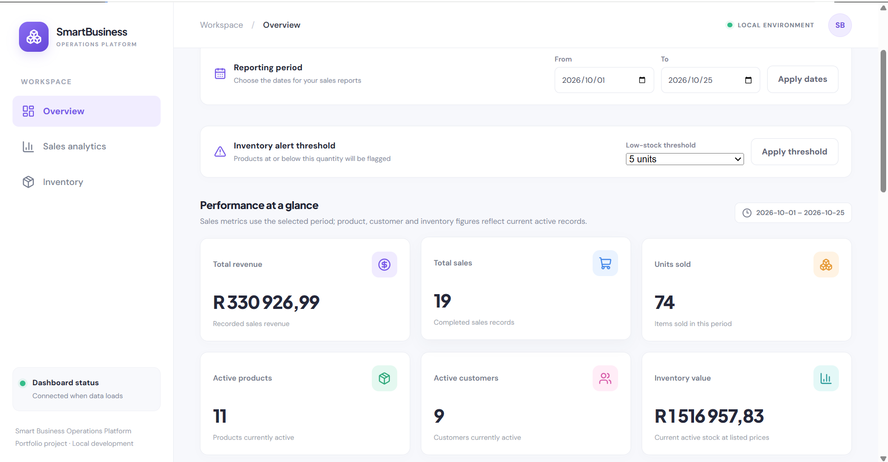
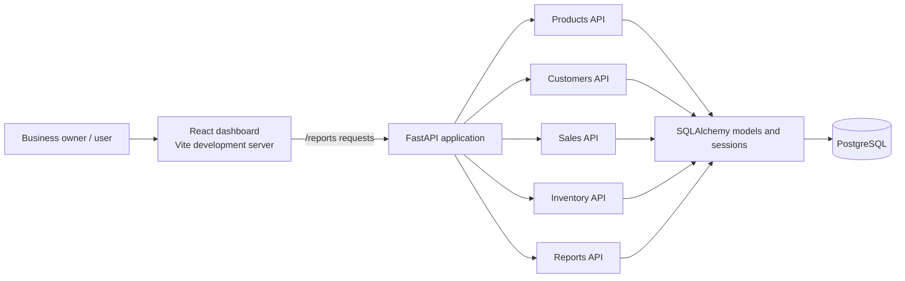

# Smart Business Operations Platform

A full-stack portfolio project for managing day-to-day business operations and turning sales and inventory records into measurable business insights. The platform combines a **FastAPI** backend, **PostgreSQL** database, and **React + Vite** dashboard.

> **Demo data notice:** `seed_demo_data.py` creates clearly labelled sample records (`DEMO-*` SKUs) for demonstrations. Treat these as fictional data, not real business performance.

## Dashboard preview




## Features

### Products and inventory
- Create, list, update, and deactivate products.
- Record stock-in, stock-out, and adjustment movements.
- Keep a transaction history for inventory changes, including opening stock and sale-related movements.
- Identify active products at or below a configurable low-stock threshold.

### Customers and sales
- Create, list, update, and deactivate customers.
- Create sales linked to customers and products.
- Validate product availability and stock before a sale is committed.
- Store sale-item snapshots of product name, SKU, unit price, quantity, and line total.
- Deduct inventory and record corresponding stock-out transactions when a sale succeeds.

### Analytics dashboard
- Sales count, revenue, and units sold for a selected reporting period.
- Top-selling product ranking by units sold and revenue.
- Current active-product and active-customer counts.
- Current inventory value based on active product stock and listed prices.
- Inventory health summary using stock units and product counts.
- Configurable low-stock threshold and reporting date filters.
- Loading and error states for dashboard requests.

**Metric interpretation:** sales, revenue, units sold, and product rankings are period-based when date filters are applied. Active product/customer counts and inventory value describe the current state of the database.

## Technology stack

| Layer | Technology |
|---|---|
| Frontend | React, Vite, JavaScript |
| Charts and icons | Recharts, Lucide React |
| Frontend testing | Vitest, jsdom, React Testing Library |
| Backend API | Python, FastAPI, Uvicorn |
| Data access | SQLAlchemy |
| Database | PostgreSQL with Psycopg 3 driver |
| Backend testing | Pytest, HTTPX, SQLite-based test fixtures |

## Architecture



### Repository layout

```text
Smart_Business_Operations_Platform/
├── app/
│   ├── api/                 # FastAPI route modules
│   ├── core/                # Application configuration
│   ├── db/                  # SQLAlchemy base and database session
│   ├── models/              # Database models
│   ├── schemas/             # Request and response schemas
│   └── main.py              # FastAPI app and router registration
├── docs/
│   └── screenshots/         # Project screenshots
├── frontend/
│   ├── public/              # Static assets and favicon
│   └── src/                 # React dashboard and frontend tests
├── tests/                   # Backend tests
├── seed_demo_data.py        # Safe, labelled demo-data seeder
├── requirements.txt         # Python dependencies
├── .env.example             # Environment variable template
└── README.md
```

## Requirements

- Python 3.11 or newer
- Node.js and npm compatible with the installed Vite version
- PostgreSQL 18 (or a compatible supported PostgreSQL version)
- Git (optional, for cloning the repository)

## Local setup (Windows PowerShell)

Run commands from the project root unless a step says to change directories.

### 1. Get the project and create a Python environment

```powershell
py -3.11 -m venv .venv
.\.venv\Scripts\Activate.ps1
python -m pip install --upgrade pip
pip install -r requirements.txt
```

If PowerShell blocks environment activation, you can allow it for this terminal only:

```powershell
Set-ExecutionPolicy -Scope Process -ExecutionPolicy RemoteSigned
.\.venv\Scripts\Activate.ps1
```

### 2. Create the PostgreSQL database

Make sure the PostgreSQL service is running. Connect with a PostgreSQL account that can create databases:

```powershell
psql -U postgres -h localhost -p 5432 -d postgres
```

At the `postgres=#` prompt, run the SQL below (do not paste the Markdown fences):

```sql
CREATE DATABASE smart_business_platform;
```

If the database already exists, do not create it again. Exit `psql` with `\q`.

### 3. Configure environment variables

Copy the example file to `.env`:

```powershell
Copy-Item .env.example .env
notepad .env
```

Set `DB_PASSWORD` to your local PostgreSQL password. Do not commit `.env` or share it publicly. The backend reads `DB_HOST`, `DB_PORT`, `DB_NAME`, `DB_USER`, and `DB_PASSWORD` from this file.

### 4. Start the backend

From the project root, with `.venv` active:

```powershell
python -m uvicorn app.main:app --reload
```

Open the API documentation manually at <http://127.0.0.1:8000/docs>. Health checks are available at <http://127.0.0.1:8000/health> and <http://127.0.0.1:8000/health/database>.

The application creates missing tables during startup. This does not replace a database migration strategy for a production deployment.

### 5. Install and start the frontend

Open a second terminal:

```powershell
Set-Location .\frontend
npm install
npm run dev
```

Open the local URL printed by Vite (normally <http://localhost:5173>). The Vite development server proxies dashboard `/reports` requests to `http://127.0.0.1:8000`.

### 6. Load sample data (optional)

Stop and review your current database state first. Back up any important data before seeding. From the project root with the backend environment active, run:

```powershell
python seed_demo_data.py
```

The script creates 10 demo products, 8 demo customers, and up to 30 sales, along with sale items and inventory movements. It checks for existing `DEMO-*` products and stops instead of duplicating the demo dataset. It does not delete existing records. If demo products already exist, it will not repair or overwrite them.

The demo data is inserted into the configured PostgreSQL database. Do not run the seeder against a production database.

## Testing and production build

### Backend tests

From the project root, with `.venv` active:

```powershell
python -m pytest -v
```

### Frontend tests

From `frontend/`:

```powershell
npm test
```

### Frontend production build

From `frontend/`:

```powershell
npm run build
```

The generated production assets are written to `frontend/dist/`, which is excluded from Git.

## API overview

The interactive API documentation at `/docs` is the source of truth for request and response schemas. Main route groups include:

- `/products` — product management
- `/customers` — customer management
- `/sales` — sales and sale details
- `/inventory` — inventory transactions and movement history
- `/reports` — summary, top products, low stock, and inventory health
- `/health` and `/health/database` — service health checks

## Security and data notes

- Keep `.env`, database passwords, access tokens, and other secrets out of Git.
- Demo customer details use fictional names and reserved `example.com` email addresses.
- Demo records are for local demonstrations and tests, not real business reporting.
- Use a separate test database/configuration for development and automated tests.
- Before production deployment, configure migrations, authentication/authorization, backups, CORS, HTTPS, logging, and environment-specific secrets management.

## Quality checks

Run the following checks from the relevant directories before submitting changes:

- Backend tests: `python -m pytest -v` from the project root.
- Frontend tests: `npm test` from `frontend/`.
- Production build: `npm run build` from `frontend/`.

These commands verify automated tests and frontend compilation. They do not replace a manual end-to-end check against a configured PostgreSQL database.

## Future improvements

Potential next steps include JavaScript code splitting to reduce the initial bundle size, broader integration coverage for complete CRUD workflows, database migrations for schema changes, and production deployment configuration.

## License

No open-source license has been selected yet. Add a `LICENSE` file before explicitly granting reuse rights.
